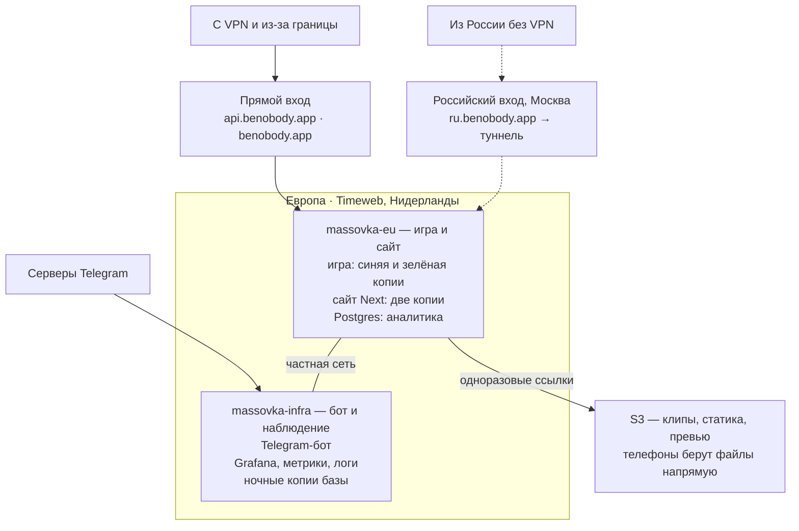

# План системного улучшения инфраструктуры

Статус: **план, не начат** (23.11.2026). Источник — Claude Doc «Массовка — план системного улучшения инфраструктуры» (https://claude.ai/artifact/16eQwYpex1KfzU8QgVqp5m). Документ рабочий: агент отмечает выполненное (`[x]`) и дописывает решения по ходу. Как устроено сейчас — `docs/server-migration.md › 12`.

## Коротко

Игра, сайт и бот переезжают в Европу (Timeweb, Нидерланды). Москва остаётся запасным входом для тех, кто играет без VPN, если замер покажет, что он нужен. Выкладка перестаёт обрывать матчи: новая версия поднимается рядом со старой, а старая доигрывает идущие матчи. Видео, статика и превью ссылок уезжают в S3.

Что получит игрок:

- игроки с VPN перестанут ловить «не подключается» и обрывы: сейчас из европейских дата-центров к Москве проходит 4 соединения из 20;
- никто не вылетает из матча из-за обновления игры;
- сайт не моргает при выкладке, а открытые старые вкладки и PWA не ломаются;
- клипы и превью ссылок грузятся быстрее и не отнимают процессор у матчей;
- в пике новички не получают «сервер занят» из-за общего адреса мобильного оператора.

Размер серверов в план не входит: по решению владельца его увеличим позже. Лимит комнат ставим под нынешнюю память, чтобы при перегрузке игрок видел «сервер занят», а не лаги у всех.

## Почему Европа и зачем Москва

Москва плохо принимает соединения из зарубежных дата-центров, а именно там стоят выходы VPN. По диагностике 23.11 из нашего сервера в Нидерландах к порту 443 Москвы прошло 4 соединения из 20, а из Москвы в Нидерланды — 0 из 20. Если большинство играет через VPN, игра в Москве для них — лотерея на каждом переподключении.

| Кто | До Москвы | До Европы |
|---|---|---|
| Из России с VPN (выход в европейском дата-центре) | плохо: фильтр режет вход из дата-центров (у нас 4 из 20) | хорошо |
| Из России без VPN | хорошо, в том числе при «белых списках» мобильного интернета | под вопросом: Hetzner, DigitalOcean и другие хостинги режут, Timeweb в Нидерландах из домашних сетей не проверен |
| Из-за границы без VPN | чаще да: серверы GitHub достают стабильно, но часть сетей режется | хорошо |

Поэтому схема такая: **один игровой сервер в Европе и два входа в него**. Все комнаты живут в одном месте, поэтому компания, где один с VPN, а другой без, играет вместе.

- **Прямой вход** — `api.benobody.app` в Европе: для VPN и зарубежных игроков.
- **Российский вход** — `ru.benobody.app` в Москве: пересылает игру в Европу по туннелю, который держит европейский сервер (так же сегодня работает бот). Телефон при запуске за долю секунды пробует оба входа и берёт тот, что ответил.
- Пропускная способность туннеля — около 0,22 МБ/с (замер 23.11), игроку нужно 1,85 КБ/с (нагрузочный прогон). Один туннель тянет примерно 100 игроков без VPN, дальше нужно несколько туннелей параллельно.

Схема после переезда (пунктир — российский вход: строим, если замер покажет, что он нужен):

Комнаты живут только на `massovka-eu`, поэтому с любого входа игрок попадает в ту же комнату, а бот и наблюдение связаны с игрой без туннелей.

Развилка по данным этапа 0: если Европа отвечает хотя бы 95% игроков из России без VPN, российский вход не строим и Москву выключаем. Если меньше — строим.

## Этап 0 — замеры и быстрые правки

За 1–2 дня работы узнаём, кто до какого сервера достаёт, и закрываем дыры, которые не зависят от переезда. Дальше 2–3 дня плейтестов копят данные для развилки.

- [ ] **Замер доступности.** Телефон в фоне пробует Москву и европейский сервер: HTTPS и рукопожатие WebSocket, удалось или нет, за сколько мс. Событие `net_probe` уходит на тот сервер, что ответил.
- [ ] **С VPN или без.** Сервер дописывает к событию страну адреса по бесплатной базе GeoIP (сам адрес не храним). Русский язык и часовой пояс России при зарубежном адресе — «скорее всего VPN».
- [ ] **Невидимые отказы.** Не смог подключиться — телефон запоминает это и отсылает при первой удачной связи. Сейчас аналитика идёт на тот же сервер, и те, кто до него не достал, не видны вообще.
- [ ] **Ошибки на телефонах.** `window.onerror` и непойманные обещания → `POST /v1/errors` → журнал → VictoriaLogs. В Grafana — панель по браузерам, тревога на всплеск после выкладки. Без Bugsink: его некуда поставить на нынешние серверы.
- [ ] **IPv6.** 22.11 записи AAAA для `benobody.app` и `www` вели на адрес Timeweb `2a03:6f00:1::5c35:60df`, а не на наш сервер. Проверить и удалить через API Timeweb или выдать серверу настоящий IPv6. Сторож начинает проверять и IPv6.
- [ ] **Выкладка только после зелёного CI.** Сейчас `web-deploy` и `game-deploy` идут параллельно с CI, и сломанный push попадает в прод. Сделать одну цепочку: проверки, потом выкладка.
- [ ] **Стоп-кран.** Переменная репозитория `DEPLOY_FREEZE=1`: выкладка только вручную. Нужна до конца этапа 1 и на время рекламных залпов.
- [ ] **Лимит комнат под память.** Нагрузочный прогон 23.11: 250 комнат = 440 МБ и 46% одного ядра, около 1,5 МБ на комнату. `MAX_ROOMS` из окружения, на нынешнем сервере — 150 (сейчас 2000). `MemoryMax` службы — не больше физической памяти (сейчас 2 ГБ при 1 ГБ на машине).

## Этап 1 — выкладка без обрыва матчей

Сейчас перезапуск сервера закрывает все комнаты (они живут только в памяти), и игроки видят «комната закрыта». После этапа новая версия поднимается рядом, старая доигрывает матчи, а лобби незаметно переезжают. Так же сделаем и переезд в Европу в этапе 3, поэтому этот этап идёт первым. Работы — около 2 дней.

**Игровой сервер: синий и зелёный на одной машине**

1. Две копии службы: `massovka-game@blue` и `massovka-game@green`, каждая на своём порту. Caddy ведёт `/i/blue/ws` и `/i/green/ws` на свою копию, а `/v1/*` — на активную. Адрес с цветом уже заложен в код (`/i/<instance>/ws`).
2. Комнату находит любая копия: если кода нет у себя, она спрашивает соседку по внутреннему адресу и отдаёт её `wsUrl`. База для справочника комнат не нужна.
3. Выкладка: новая версия стартует в свободном цвете → `readyz` → живой прогон четырёх игроков прямо на ней → Caddy переключает активный цвет → старая копия получает команду «досиживать». Прогон не прошёл — переключения нет, игроки ничего не заметили.
4. Старая копия в режиме drain: новых комнат не создаёт, идущие матчи доигрывает. Комната в лобби (или вернувшаяся в лобби после матча) переезжает: состав, цвета, имена, «Готов», настройки, режиссёр и зрители уходят снимком в новую копию с тем же кодом.
5. Игроки переезжающей комнаты получают новое сообщение `{ t: 'move', wsUrl }`, и `ServerLink` переподключается с тем же токеном и кодом. Для игрока это доля секунды в лобби. Ключ подписи токенов у копий общий.
6. Через 20 минут (матч идёт около 5) старая копия завершается сама. Матч, доживший до срока, прерывается и пишется в журнал — это редкость.
7. Откат — переключить активный цвет обратно. Пять последних версий уже хранятся на диске.

**Совместимость со старыми вкладками**

- Клиент с поддержкой `move` выкатываем раньше сервера и включаем переезд сутки спустя: устаревшая вкладка игнорирует незнакомое сообщение и переезд пропустит.
- Сервер принимает текущую и прошлую `WIRE_VERSION`; протокол меняем только расширением. Записать правилом в CLAUDE.md.

**Сайт без простоя**

- Две копии Next на разных портах: новая стартует, отвечает 200 → Caddy переключается → старая останавливается через минуту. Сейчас выкладка даёт до 40 секунд ошибки 502.
- Старые файлы `_next/static` остаются доступны, чтобы открытая вкладка не перезагружалась сама. До S3 — копируем статику прошлых версий в новую, после S3 все версии лежат там.

**Как проверяем**

- [ ] Тест в `apps/server/test`: лобби переезжает с тем же составом и цветами, матч доигрывается на старой копии, утечек игроков нет.
- [ ] Живой прогон через выкладку: `game-deploy` запускает матч четырёх игроков до переключения, и он обязан дойти до конца без `closed`.
- [ ] Сайт: во время выкладки запросы раз в секунду — ни одной ошибки 5xx.

## Этап 2 — S3 для видео, статики и превью

Сервер перестаёт раздавать файлы и занимается только игрой и страницами. Работы — 1,5–2 дня. Хранилище ставим там же, где игру, и проверяем его тем же замером из этапа 0.

- [ ] **Где S3.** Спросить API Timeweb, в каких городах есть хранилище (так же, как проверяли тарифы в `infra-check.yml`). Есть в Европе — берём его: один счёт и один `TWC_TOKEN`. Нет — европейский S3 другого провайдера (выбираем владелец и агент по данным замера). Cloudflare и Hetzner не подходят: их режут в России.
- [ ] **Клипы.** Телефон просит у сервера одноразовую ссылку загрузки (с лимитом 12 МБ и типом файла) и грузит клип прямо в S3. Правило хранилища удаляет клипы через 2 суток. Telegram и скачивание берут файл по адресу `clips.benobody.app`. Лимит папки в 1 ГБ на сервере уходит. Старый `POST /v1/clips` живёт ещё неделю для открытых вкладок.
- [ ] **Статика сайта.** `assetPrefix` Next → `static.benobody.app`. Выкладка заливает `.next/static` с `Cache-Control: immutable` на год и ничего не удаляет сразу (старые версии чистятся через 30 дней), поэтому старые вкладки и PWA не ловят 404. `sw.js` и манифест остаются на сайте: сервис-воркер обязан жить на своём адресе. Для шрифтов — CORS на бакете. Проверить, что сервис-воркер и песочница без сети работают с чужим адресом статики.
- [ ] **Превью ссылок.** Общие картинки (язык × тема × страница) рисуются при сборке и лежат в S3, метатег указывает туда. Картинка комнаты с именем режиссёра рисуется один раз на комнату и язык, кладётся в S3 на час, а следующие боты превью получают её оттуда. Сейчас каждый запрос заново рисует PNG на единственном ядре.
- [ ] **Для игроков без VPN.** Если российский вход нужен, Москва отдаёт статику и превью из своего кеша (копия статики приезжает с выкладкой), а не гонит мегабайты через туннель.

Секреты S3 — в GitHub Secrets и файлом на сервере, как остальные. Телефон ключей не видит — только одноразовые ссылки.

## Этап 3 — переезд игры в Европу

Переезд идёт тем же механизмом, что выкладка из этапа 1, только «соседняя копия» стоит в другой стране: матчи доигрываются в Москве, лобби переезжают, новые комнаты создаются уже в Европе. Работы — 2–3 дня плюс сутки на DNS.

**Сервер**

- Новый `massovka-eu` в Timeweb, Нидерланды: игра (синий/зелёный), сайт, Postgres, Caddy. Размер пока как у Москвы, увеличим позже. Тот же `game-deploy` с новой ролью `eu`, тот же `setup.sh`.
- Наблюдение и бот остаются на `massovka-infra` в той же локации. Связь с ним — по приватной сети Timeweb, без фильтров и туннелей. `/tg/*` идёт напрямую, и самое хрупкое звено для Telegram исчезает.

**Порядок переезда**

1. За сутки — TTL записей `benobody.app`, `www` и `api` до 60 с.
2. Поднять `massovka-eu`, прогнать живой матч по его адресу `sslip.io`.
3. Перенести базу: копия Москвы → Европа. Аналитика за минуты переключения доливается следом.
4. Москва переходит в drain: лобби уезжают в Европу через туннель, матчи доигрываются на месте.
5. DNS `api` и `benobody.app` → Европа. Пока записи расходятся, Москва на незнакомый код спрашивает Европу и отдаёт её `wsUrl`. Старые вкладки и PWA с адресом `api.benobody.app` уходят в Европу сами.
6. Адрес Mini App в BotFather не меняется: это всё тот же `benobody.app`.

**Российский вход (только если замер скажет «нужен»)**

- `ru.benobody.app` в Москве: копия сайта и статики на месте, а `/v1/*` и WebSocket — по туннелю в Европу. Туннелей два–три параллельно: и запас, и пропускная способность.
- Сервер строит `wsUrl` по тому входу, через который пришёл игрок, из списка разрешённых адресов.
- Клиент: `GAME_API` становится списком входов; при запуске телефон пробует оба, запоминает лучший и при обрыве переключается на другой. Комната одна, и с любого входа игрок попадает в неё.
- Открытый вопрос: как игроку без VPN открыть саму страницу, если `benobody.app` в Европе для него недоступен. Умолчание: кнопка бота «Не открывается? Играть без VPN» со ссылкой на `ru.benobody.app`, а у вернувшихся игроков страница уже лежит в сервис-воркере. Два адреса в одной записи DNS спасают только от полного отказа соединения, а не от «зависания» после 16 КБ.

**Если российский вход не нужен** — Москва работает неделю пересылкой для запоздавших DNS и выключается.

## Этап 4 — защита от всплеска

Итог этапа: пик из рекламы не отсекает новичков по ошибке, а предел сервера известен заранее. Работы — около 1,5 дня, часть можно делать параллельно с этапами 1–3.

- [ ] **Лимиты без наказания за общий адрес.** Сейчас с одного IP можно 30 входов и 10 комнат в минуту и 20 соединений, а у мобильных операторов и у VPN за одним адресом тысячи людей. Комнаты — по игроку (5 в минуту на токен), по IP — только грубая страховка от ботов (порядка 300 входов и 200 соединений). Точные числа — по данным этапа 0: сколько игроков реально приходит с одного адреса.
- [ ] **Нагрузочный прогон в репозитории.** `apps/server/scripts/load.ts` (черновик написан при ревью, в репозитории его пока нет) и ручной workflow: N комнат × 4 игрока против сервера. Критерии: шаг матча p99 < 5 мс, память на комнату и задержка рассылки в отчёте. Гоняем ночью перед кампанией и после увеличения сервера.
- [ ] **Перегрузка — вежливо.** Достигнут `MAX_ROOMS` — текст в стиле игры («Площадка занята, попробуй через минуту») и кнопка «Играть с ботами»: песочница работает без сервера. Идущие матчи не страдают.
- [ ] **Тревоги до того, как сломалось.** К сегодняшним (диск и память) добавить: комнат больше 80% лимита, шаг матча p99 > 20 мс, ошибки 5xx сайта, всплеск ошибок с телефонов, доля неудачных подключений выше 5%, сертификат < 14 дней. Туннели российского входа — тревога через 2 минуты, а не через 5.
- [ ] **Проверка копий.** Раз в неделю workflow восстанавливает свежую копию базы во временный Postgres и считает строки.
- [ ] **Памятка на день кампании** в `docs/`: включить `DEPLOY_FREEZE`, какую панель Grafana держать открытой, что делать при «занято», западании туннеля или бота.
- [ ] **Документы.** `CLAUDE.md` и `docs/server-migration.md` — новая схема, правило совместимости протокола, порядок выкладки и отката.

## Порядок, решения и риски

Весь план — примерно 9–10 дней работы, в неделю до мягкого запуска 1 декабря всё не влезает. До 1.12 делаем этап 0, этап 1 и лимиты из этапа 4: они самые дешёвые и убирают обрывы. Этапы 2 и 3 — первая неделя декабря. Большую рекламу лучше запускать после этапа 3: переезжать накануне залпа рискованно.

Дорожная карта (даты — ориентир):

| Когда | Этап | Что |
|---|---|---|
| 24–27 ноября | Этап 0 · замеры | кто куда достаёт; CI, стоп-кран, IPv6 |
| 25–28 ноября | Этап 1 · выкладка | синий и зелёный, матчи не рвутся |
| **1 декабря** | веха | мягкий запуск |
| 2–3 декабря | Этап 2 · S3 | клипы, статика, превью ссылок |
| 4–7 декабря | Этап 3 · Европа | игра, сайт, база; Москва — по замеру |
| **≈ 8 декабря** | веха | большая реклама |
| параллельно | Этап 4 · защита от всплеска | лимиты — до 1 декабря, тревоги и нагрузочный тест — параллельно |

**Решения владельца (если ответа нет — идём по умолчанию)**

| Вопрос | Умолчание |
|---|---|
| Когда большая реклама | после этапа 3; 1.12 — мягкий запуск со стоп-краном выкладок |
| Игра в Европе: новый сервер или на `massovka-infra` | новый `massovka-eu` того же размера, что Москва: игра не делит процессор с Grafana |
| Где S3 | Timeweb, если там есть Европа; иначе выбираем по замеру |
| Российский вход в Москве | решает замер этапа 0 (порог 95%) |
| Стоимость нового сервера и S3 | смотрим цены API Timeweb в день заказа и присылаем до покупки |

**Риски**

| Риск | Что делаем |
|---|---|
| Из России без VPN до Европы не достать | российский вход из этапа 3 и кнопка бота «Играть без VPN» |
| Туннель даёт лаги на плохой линии (TCP внутри SSH) | несколько туннелей, пинг через российский вход в `net_probe` и в Grafana |
| Ошибка в переезде лобби | флаг `ROOM_MOVE=0` возвращает простое «доиграть и закрыть» |
| Старые вкладки и PWA не понимают новый протокол | только расширяющие изменения, две версии протокола сразу, клиент раньше сервера |
| Переезд совпадёт с пиком игроков | ночь по Москве, стоп-кран выкладок, откат DNS за 60 с |
