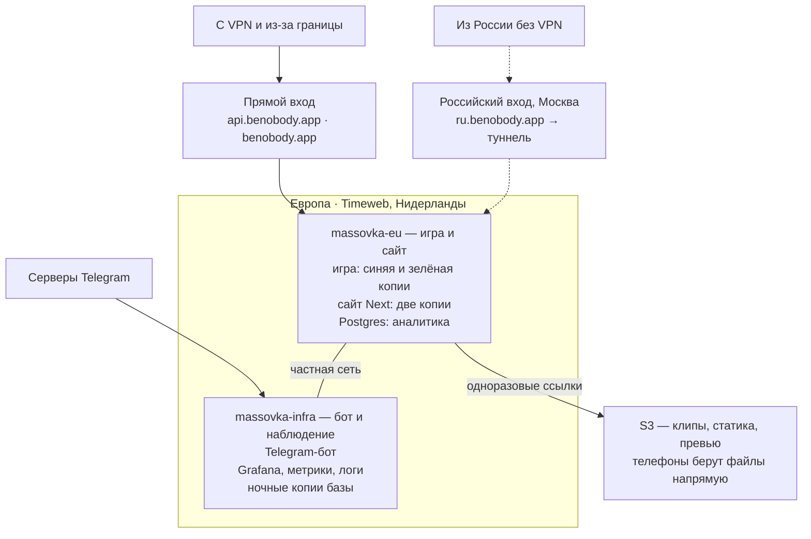

# План системного улучшения инфраструктуры

Статус: **идёт** — этапы 0, 1 и 4 сделаны 24.11.2026 (ниже отмечено `[x]`), этап 3 (Европа) сделан 24.11 (Москва неделю пересылает запоздавших); этап 2 (S3) ждёт решения владельца (цены — `infra-check`, шаг «S3 и серверы в Нидерландах»). Источник — Claude Doc «Массовка — план системного улучшения инфраструктуры» (https://claude.ai/artifact/16eQwYpex1KfzU8QgVqp5m). Документ рабочий: агент отмечает выполненное (`[x]`) и дописывает решения по ходу. Как устроено сейчас — `docs/server-migration.md › 12`.

## Коротко

Игра, сайт и бот переезжают в Европу (Timeweb, Нидерланды). Москва остаётся запасным входом для тех, кто играет без VPN, если замер покажет, что он нужен. Выкладка перестаёт обрывать матчи: новая версия поднимается рядом со старой, а старая доигрывает идущие матчи. Видео, статика и превью ссылок уезжают в S3.

Что получит игрок:

- игроки с VPN перестанут ловить «не подключается» и обрывы: сейчас из европейских дата-центров к Москве проходит 4 соединения из 20;
- никто не вылетает из матча из-за обновления игры;
- сайт не моргает при выкладке, а открытые старые вкладки и PWA не ломаются;
- клипы и превью ссылок грузятся быстрее и не отнимают процессор у матчей;
- в пике новички не получают «сервер занят» из-за общего адреса мобильного оператора.

Размер серверов в план не входит: по решению владельца его увеличим позже. Лимит комнат ставим под нынешнюю память, чтобы при перегрузке игрок видел «сервер занят», а не лаги у всех.

## Почему Европа и зачем Москва

Москва плохо принимает соединения из зарубежных дата-центров, а именно там стоят выходы VPN. По диагностике 23.11 из нашего сервера в Нидерландах к порту 443 Москвы прошло 4 соединения из 20, а из Москвы в Нидерланды — 0 из 20. Если большинство играет через VPN, игра в Москве для них — лотерея на каждом переподключении.

| Кто | До Москвы | До Европы |
|---|---|---|
| Из России с VPN (выход в европейском дата-центре) | плохо: фильтр режет вход из дата-центров (у нас 4 из 20) | хорошо |
| Из России без VPN | хорошо, в том числе при «белых списках» мобильного интернета | под вопросом: Hetzner, DigitalOcean и другие хостинги режут, Timeweb в Нидерландах из домашних сетей не проверен |
| Из-за границы без VPN | чаще да: серверы GitHub достают стабильно, но часть сетей режется | хорошо |

Поэтому схема такая: **один игровой сервер в Европе и два входа в него**. Все комнаты живут в одном месте, поэтому компания, где один с VPN, а другой без, играет вместе.

- **Прямой вход** — `api.benobody.app` в Европе: для VPN и зарубежных игроков.
- **Российский вход** — `ru.benobody.app` в Москве: пересылает игру в Европу по туннелю, который держит европейский сервер (так же сегодня работает бот). Телефон при запуске за долю секунды пробует оба входа и берёт тот, что ответил.
- Пропускная способность туннеля — около 0,22 МБ/с (замер 23.11), игроку нужно 1,85 КБ/с (нагрузочный прогон). Один туннель тянет примерно 100 игроков без VPN, дальше нужно несколько туннелей параллельно.

Схема после переезда (пунктир — российский вход: строим, если замер покажет, что он нужен):

Комнаты живут только на `massovka-eu`, поэтому с любого входа игрок попадает в ту же комнату, а бот и наблюдение связаны с игрой без туннелей.

Развилка по данным этапа 0: если Европа отвечает хотя бы 95% игроков из России без VPN, российский вход не строим и Москву выключаем. Если меньше — строим.

## Этап 0 — замеры и быстрые правки

За 1–2 дня работы узнаём, кто до какого сервера достаёт, и закрываем дыры, которые не зависят от переезда. Дальше 2–3 дня плейтестов копят данные для развилки.

- [x] **Замер доступности.** Телефон в фоне пробует Москву и европейский сервер: HTTPS и рукопожатие WebSocket, удалось или нет, за сколько мс. Событие `net_probe` уходит на тот сервер, что ответил. Сделано 24.11: `apps/web/src/lib/netprobe.ts` раз в сутки на телефон пробует `/v1/probe`, `/v1/probe?kb=64` (ловит глушение после 16 КБ) и WebSocket `/ws` у Москвы и у сервера в Нидерландах (`NEXT_PUBLIC_EU_PROBE`); сервер в Нидерландах пересылает события в Москву по туннелю (`EVENTS_UPSTREAM`). Итог — таблица «Доступность серверов» в Grafana «игроки и матчи».
- [x] **С VPN или без.** Сервер дописывает к событию страну адреса по бесплатной базе GeoIP (сам адрес не храним). Русский язык и часовой пояс России при зарубежном адресе — «скорее всего VPN». Сделано 24.11: `apps/server/src/geo.ts`, база DB-IP Country Lite из npm `@ip-location-db/dbip-country-mmdb` (db-ip.com из наших сред закрыт) — привозит `game-deploy`, страна пишется в `cc` только у `net_probe`/`net_fail`.
- [x] **Невидимые отказы.** Не смог подключиться — телефон запоминает это и отсылает при первой удачной связи. Сейчас аналитика идёт на тот же сервер, и те, кто до него не достал, не видны вообще. Сделано 24.11: любая пачка аналитики, не ушедшая из-за сети, ложится в `kto:outbox` (до 60 событий) и уходит при первой удачной связи — с `late_s`; замер отправляет отложенное и через Европу.
- [x] **Ошибки на телефонах.** `window.onerror` и непойманные обещания → `POST /v1/errors` → журнал → VictoriaLogs. В Grafana — панель по браузерам, тревога на всплеск после выкладки. Без Bugsink: его некуда поставить на нынешние серверы. Сделано 24.11: `apps/web/src/lib/errors.ts` (до 10 разных за заход, шум отброшен, версия сайта — `NEXT_PUBLIC_BUILD`), сервер пишет `client_error` в журнал и считает `game_client_errors_total`; в Grafana «серверы» — график и лента ошибок, сторож тревожит при > 30 за 10 минут. Заодно `game_rooms_limit` и тревога «комнат > 80% лимита» (этап 4).
- [ ] **IPv6.** 22.11 записи AAAA для `benobody.app` и `www` вели на адрес Timeweb `2a03:6f00:1::5c35:60df`, а не на наш сервер. Проверить и удалить через API Timeweb или выдать серверу настоящий IPv6. Сторож начинает проверять и IPv6. 24.11: домен живёт не в аккаунте Cloud (API отвечает 404), удалить записи может только владелец в панели DNS Timeweb; `infra-domain` печатает лишние AAAA, сторож тревожит, пока они есть (`dns_aaaa`, dig к 8.8.8.8).
- [x] **Выкладка только после зелёного CI.** Сейчас `web-deploy` и `game-deploy` идут параллельно с CI, и сломанный push попадает в прод. Сделано 24.11: сборка идёт сразу, а шаги, которые меняют серверы, ждут зелёный CI того же коммита (`infra/ci-wait.sh`, до 20 минут).
- [x] **Стоп-кран.** Переменная репозитория `DEPLOY_FREEZE=1`: выкладка только вручную. Нужна до конца этапа 1 и на время рекламных залпов. Сделано 24.11: условие на job в обеих выкладках; ручной запуск работает всегда, аварийно — с `skip_ci=true`.
- [x] **Лимит комнат под память.** Нагрузочный прогон 23.11: 250 комнат = 440 МБ и 46% одного ядра, около 1,5 МБ на комнату. `MAX_ROOMS` из окружения, на нынешнем сервере — 150 (сейчас 2000). `MemoryMax` службы — не больше физической памяти (сейчас 2 ГБ при 1 ГБ на машине). Сделано 24.11: `setup.sh` считает `MAX_ROOMS` = (память − 600 МБ) / 2 МБ (1 ГБ → ~150) и ставит `MemoryHigh` 75% / `MemoryMax` 90% памяти машины. 24.11 пересчитано по прогону с ходьбой и полным матчем: память комнаты растёт к концу матча (живых данных ~2,5 МБ, с кучей 120 МБ 60 комнат падают) — теперь 3 МБ на комнату, 1 ГБ → ~100 комнат. Прогон против Москвы 24.11 (110 комнат, днём, раннер GitHub в США): на 98 комнатах процессор ~100%, пинг через матч p50 0,2–0,5 с, p99 до 3,4 с, 8 комнат не вошли — узкое место одно ядро (игра + TLS + сайт). Потолок теперь ещё и 40 комнат на ядро: Москва — 40 (160 игроков). Проверено прогоном на 45 комнат (24.11, днём): потолок сработал (40 вошли, 5 — «занято», ни одного сбоя), процессор 26–96% (в среднем ~60%), шаг матча p99 ~5 мс, память игры 270 МБ (свободно 320 МБ); пинг через матч p50 ~140 мс (это расстояние США → Москва), p99 обычно 230–550 мс, пики до 740 мс — редкие подтормаживания. 40 комнат на ядро — рабочий предел, не с запасом.

## Этап 1 — выкладка без обрыва матчей

Сейчас перезапуск сервера закрывает все комнаты (они живут только в памяти), и игроки видят «комната закрыта». После этапа новая версия поднимается рядом, старая доигрывает матчи, а лобби незаметно переезжают. Так же сделаем и переезд в Европу в этапе 3, поэтому этот этап идёт первым. Работы — около 2 дней.

**Игровой сервер: синий и зелёный на одной машине**

1. Две копии службы: `massovka-game@blue` и `massovka-game@green`, каждая на своём порту. Caddy ведёт `/i/blue/ws` и `/i/green/ws` на свою копию, а `/v1/*` — на активную. Адрес с цветом уже заложен в код (`/i/<instance>/ws`).
2. Комнату находит любая копия: если кода нет у себя, она спрашивает соседку по внутреннему адресу и отдаёт её `wsUrl`. База для справочника комнат не нужна.
3. Выкладка: новая версия стартует в свободном цвете → `readyz` → живой прогон четырёх игроков прямо на ней → Caddy переключает активный цвет → старая копия получает команду «досиживать». Прогон не прошёл — переключения нет, игроки ничего не заметили.
4. Старая копия в режиме drain: новых комнат не создаёт, идущие матчи доигрывает. Комната в лобби (или вернувшаяся в лобби после матча) переезжает: состав, цвета, имена, «Готов», настройки, режиссёр и зрители уходят снимком в новую копию с тем же кодом.
5. Игроки переезжающей комнаты получают новое сообщение `{ t: 'move', wsUrl }`, и `ServerLink` переподключается с тем же токеном и кодом. Для игрока это доля секунды в лобби. Ключ подписи токенов у копий общий.
6. Через 20 минут (матч идёт около 5) старая копия завершается сама. Матч, доживший до срока, прерывается и пишется в журнал — это редкость.
7. Откат — переключить активный цвет обратно. Пять последних версий уже хранятся на диске.

**Совместимость со старыми вкладками**

- Клиент с поддержкой `move` выкатываем раньше сервера и включаем переезд сутки спустя: устаревшая вкладка игнорирует незнакомое сообщение и переезд пропустит.
- Сервер принимает текущую и прошлую `WIRE_VERSION`; протокол меняем только расширением. Записать правилом в CLAUDE.md.

**Сайт без простоя**

- Две копии Next на разных портах: новая стартует, отвечает 200 → Caddy переключается → старая останавливается через минуту. Сейчас выкладка даёт до 40 секунд ошибки 502.
- Старые файлы `_next/static` остаются доступны, чтобы открытая вкладка не перезагружалась сама. До S3 — копируем статику прошлых версий в новую, после S3 все версии лежат там.

**Как проверяем**

- [x] Тест в `apps/server/test`: лобби переезжает с тем же составом и цветами, матч доигрывается на старой копии, утечек игроков нет.
- [x] Живой прогон через выкладку: `game-deploy` запускает матч четырёх игроков до переключения, и он обязан дойти до конца без `closed`.
- [ ] Сайт: во время выкладки запросы раз в секунду — ни одной ошибки 5xx.

**Как сделано (24.11)**

- Сервер: `drain()` / `POST /internal/drain` (только изнутри машины), снимок лобби `Room.snapshot()` → `POST /internal/import` у соседа → игрокам `{ t: 'move', url }` (`packages/net/src/wire.ts`), `ServerLink` сразу переподключается по новому адресу. Неизвестный код на экземпляре — спросить соседа (`/v1/rooms/<код>` и `hello`). Комната с экрана конца матча переезжает после разосланного фильма; «Ещё дубль» без раннера — новый матч. Синий и зелёный берут первую букву кода из разных половин алфавита — коды не сталкиваются.
- Инфраструктура: `massovka-game@.service` и `massovka-web@.service`, `setup.sh` (выкладка: ждёт `readyz` нового, переключает Caddy, drain старого; свободный цвет ещё доигрывает — ждёт до 15 минут), `web.sh` (статика прошлой версии за 2 суток копируется в новую), `caddy.sh` (`lb_policy first`, `stream_close_delay 2h` — WebSocket не рвутся при перезагрузке конфига; внутренний вход `127.0.0.1:8080`). Конфиг Caddy проверяется в CI (`infra/test/caddy-config.sh`, job `infra`) и на сервере перед заменой.
- Проверки: `apps/server/test/drain.test.ts` (лобби переезжает с составом, цветами, «Готов» и настройками; матч доигрывается на старом, потом переезд и реванш на новом; опоздавший по старому адресу; срок drain), браузер (два экземпляра локально, страницы остаются в лобби), `game-deploy` — «Матч через выкладку»: `SMOKE_THROUGH=1` играет 2,5 минуты, пока выкатывается новая версия. Первая выкладка с синим/зелёным оборвала матчи в последний раз (переход со старой службы).
- Проверено на проде 24.11 (выкладка c6508fb): четверо играли, пока Caddy переключался на зелёный и синий уходил в drain, — матч доигрался, 0 переподключений, миры игроков совпали.
- Осталось: проверка «сайт без 5xx во время выкладки» — смотреть по первым выкладкам (Caddy ждёт соседа до 5 с).

## Этап 2 — S3 для видео, статики и превью

Сервер перестаёт раздавать файлы и занимается только игрой и страницами. Работы — 1,5–2 дня. Хранилище ставим там же, где игру, и проверяем его тем же замером из этапа 0.

- [ ] **Где S3.** Спросить API Timeweb, в каких городах есть хранилище (так же, как проверяли тарифы в `infra-check.yml`). Есть в Европе — берём его: один счёт и один `TWC_TOKEN`. Нет — европейский S3 другого провайдера (выбираем владелец и агент по данным замера). Cloudflare и Hetzner не подходят: их режут в России.
- [ ] **Клипы.** Телефон просит у сервера одноразовую ссылку загрузки (с лимитом 12 МБ и типом файла) и грузит клип прямо в S3. Правило хранилища удаляет клипы через 2 суток. Telegram и скачивание берут файл по адресу `clips.benobody.app`. Лимит папки в 1 ГБ на сервере уходит. Старый `POST /v1/clips` живёт ещё неделю для открытых вкладок.
- [ ] **Статика сайта.** `assetPrefix` Next → `static.benobody.app`. Выкладка заливает `.next/static` с `Cache-Control: immutable` на год и ничего не удаляет сразу (старые версии чистятся через 30 дней), поэтому старые вкладки и PWA не ловят 404. `sw.js` и манифест остаются на сайте: сервис-воркер обязан жить на своём адресе. Для шрифтов — CORS на бакете. Проверить, что сервис-воркер и песочница без сети работают с чужим адресом статики.
- [ ] **Превью ссылок.** Общие картинки (язык × тема × страница) рисуются при сборке и лежат в S3, метатег указывает туда. Картинка комнаты с именем режиссёра рисуется один раз на комнату и язык, кладётся в S3 на час, а следующие боты превью получают её оттуда. Сейчас каждый запрос заново рисует PNG на единственном ядре.
- [ ] **Для игроков без VPN.** Если российский вход нужен, Москва отдаёт статику и превью из своего кеша (копия статики приезжает с выкладкой), а не гонит мегабайты через туннель.

Секреты S3 — в GitHub Secrets и файлом на сервере, как остальные. Телефон ключей не видит — только одноразовые ссылки.

## Этап 3 — переезд игры в Европу

> **Сделано 24.11.2026, 19:28:** DNS `benobody.app`, `www`, `api` → `72.56.22.216` (владелец, в панели); Москва пересылает запоздавших в Европу (самопроверка прошла), drain Москвы к Европе, база перенесена (863 события из Москвы, в Европе дальше копятся новые), живой матч по `api.benobody.app` — 0 переподключений. Москва убрана из матрицы `game-deploy`; через неделю — выключить (`docs/server-migration.md › 14`). Российский вход не строили: решать по `net_probe`, когда появятся игроки из России без VPN.
>
> **Как шло (24.11.2026).** Владелец решил переезжать сразу, без плавного переезда и не дожидаясь замера: в `net_probe` всего 8 телефонов, все с VPN или из-за границы, до Европы достают 100%.
> - Сервер `massovka-eu` — Cloud NL-30 (1 vCPU / 2 ГБ, 1560 ₽), в одном дата-центре с `massovka-infra`. Cloud NL-15 не подошёл: в Нидерландах серверы теперь создаются без IPv4, первый ушёл в `error`, второй с заказанным адресом не открыл SSH. IPv4 Timeweb выдаёт, только если на балансе не меньше 5440 ₽ (`abuse_prepayment_required`). `provision.py` повторяет заказ раз в минуту и пересоздаёт сервер, сломанный при создании (`RECREATE_BROKEN=1`, только без IPv4).
> - Европа настраивается тем же `setup.sh`, что Москва. Сертификаты `benobody.app`, `www` и `api` и ключ подписи токенов (`AUTH_SIGNING_KEY`) переносятся из Москвы трубой раннера — игроки не теряют вход, HTTPS есть с первой минуты после DNS. Адрес WebSocket — по входу (`PUBLIC_WS_HOSTS`: `api.benobody.app` и свой `sslip.io`).
> - Туннели: Нидерланды → Европа (`massovka-tunnel-eu`, порты 2xxxx: база :25432, метрики :28080, машина :29100, бот -R 9090, логи -R 9428); Европа → Москва (`massovka-relay`: -R 18090 — вход пересылки Caddy Европы `127.0.0.1:8090`, -R 18091 — внутренний вход игры для переезда комнат).
> - Первая попытка (18:16) сломала вход на 20 минут: вход пересылки Европы не узнавал `Host: api.benobody.app` (та же беда с утра у `/tg/*`), откатили (`rollback`), починили (`http://:8080`/`:8090`). DNS через API не меняется — домен не в облачном аккаунте; меняет владелец, а `infra-move.yml` в режиме `finish` ждёт DNS и делает остальное.
> - Переключение — `infra-move.yml` (режим `direct`): ждёт сайт в Европе, копирует базу (`pg_restore --clean`), Москва пересылает игру в Европу (`RELAY` в `hosts.env`, адрес игрока — `X-Massovka-Client`, проверено вживую в CI), Москва уходит в drain с соседом-Европой (`POST /internal/drain` с `{peer}`), записи A → Европа (`dns-switch.py`, TTL 60 с), живой матч по `api.benobody.app`. Откат — режим `rollback`.
> - Наблюдение смотрит туда, где живёт игра (`/etc/massovka/game-site` на `massovka-infra`): Grafana «База игры», ночные копии в `/var/backups/massovka-eu`, сторож по `server="eu"`.

Переезд идёт тем же механизмом, что выкладка из этапа 1, только «соседняя копия» стоит в другой стране: матчи доигрываются в Москве, лобби переезжают, новые комнаты создаются уже в Европе. Работы — 2–3 дня плюс сутки на DNS.

**Сервер**

- Новый `massovka-eu` в Timeweb, Нидерланды: игра (синий/зелёный), сайт, Postgres, Caddy. Размер пока как у Москвы, увеличим позже. Тот же `game-deploy` с новой ролью `eu`, тот же `setup.sh`.
- Наблюдение и бот остаются на `massovka-infra` в той же локации. Связь с ним — по приватной сети Timeweb, без фильтров и туннелей. `/tg/*` идёт напрямую, и самое хрупкое звено для Telegram исчезает.

**Порядок переезда**

1. За сутки — TTL записей `benobody.app`, `www` и `api` до 60 с.
2. Поднять `massovka-eu`, прогнать живой матч по его адресу `sslip.io`.
3. Перенести базу: копия Москвы → Европа. Аналитика за минуты переключения доливается следом.
4. Москва переходит в drain: лобби уезжают в Европу через туннель, матчи доигрываются на месте.
5. DNS `api` и `benobody.app` → Европа. Пока записи расходятся, Москва на незнакомый код спрашивает Европу и отдаёт её `wsUrl`. Старые вкладки и PWA с адресом `api.benobody.app` уходят в Европу сами.
6. Адрес Mini App в BotFather не меняется: это всё тот же `benobody.app`.

**Российский вход (только если замер скажет «нужен»)**

- `ru.benobody.app` в Москве: копия сайта и статики на месте, а `/v1/*` и WebSocket — по туннелю в Европу. Туннелей два–три параллельно: и запас, и пропускная способность.
- Сервер строит `wsUrl` по тому входу, через который пришёл игрок, из списка разрешённых адресов.
- Клиент: `GAME_API` становится списком входов; при запуске телефон пробует оба, запоминает лучший и при обрыве переключается на другой. Комната одна, и с любого входа игрок попадает в неё.
- Открытый вопрос: как игроку без VPN открыть саму страницу, если `benobody.app` в Европе для него недоступен. Умолчание: кнопка бота «Не открывается? Играть без VPN» со ссылкой на `ru.benobody.app`, а у вернувшихся игроков страница уже лежит в сервис-воркере. Два адреса в одной записи DNS спасают только от полного отказа соединения, а не от «зависания» после 16 КБ.

**Если российский вход не нужен** — Москва работает неделю пересылкой для запоздавших DNS и выключается.

## Этап 4 — защита от всплеска

Итог этапа: пик из рекламы не отсекает новичков по ошибке, а предел сервера известен заранее. Работы — около 1,5 дня, часть можно делать параллельно с этапами 1–3.

- [x] **Лимиты без наказания за общий адрес.** Сейчас с одного IP можно 30 входов и 10 комнат в минуту и 20 соединений, а у мобильных операторов и у VPN за одним адресом тысячи людей. Комнаты — по игроку (5 в минуту на токен), по IP — только грубая страховка от ботов (порядка 300 входов и 200 соединений). Точные числа — по данным этапа 0: сколько игроков реально приходит с одного адреса. Сделано 24.11: комнаты — 5 в минуту на игрока (токен) и 60 на адрес, входов — 300, соединений — 200, событий — 600 в минуту на адрес (`apps/server/src/server.ts`); пересмотреть по данным замера.
- [x] **Нагрузочный прогон в репозитории.** `apps/server/scripts/load.ts` (черновик написан при ревью, в репозитории его пока нет) и ручной workflow: N комнат × 4 игрока против сервера. Критерии: шаг матча p99 < 5 мс, память на комнату и задержка рассылки в отчёте. Гоняем ночью перед кампанией и после увеличения сервера. Сделано 24.11: `pnpm --filter @kto/server load -- --local|<адрес> --rooms N --seconds S` и `.github/workflows/load-test.yml` (local — на раннере; prod — против Москвы с `LOAD_KEY` из `secrets.env`, метрики Москвы по SSH рядом). С ключом лимиты по адресу не действуют, фильм для тестовых комнат не монтируется. Первый замер (локально, 60 комнат × 4 с ходьбой): 23% ядра, ~2,6 МБ на комнату, пинг через матч p99 12 мс.
- [x] **Перегрузка — вежливо.** Достигнут `MAX_ROOMS` — текст в стиле игры («Площадка занята, попробуй через минуту») и кнопка «Играть с ботами»: песочница работает без сервера. Идущие матчи не страдают. Сделано 24.11: главная — «Площадка переполнена. Зайди через минуту, а пока — «Играть» с ботами» (влезает на iPhone SE), экран комнаты — тот же смысл и кнопка «Играть с ботами».
- [x] **Тревоги до того, как сломалось.** К сегодняшним (диск и память) добавить: комнат больше 80% лимита, шаг матча p99 > 20 мс, ошибки 5xx сайта, всплеск ошибок с телефонов, доля неудачных подключений выше 5%, сертификат < 14 дней. Туннели российского входа — тревога через 2 минуты, а не через 5. Сделано 24.11 (кроме туннелей — их пока нет и 5xx по логам Caddy): шаг p99 > 20 мс, комнаты > 80% лимита, ошибки JS, страница песочницы, сертификаты < 14 дней (раз в час, `openssl` из Нидерландов), зависший drain; потолок комнат — на графике «Онлайн и комнаты».
- [x] **Проверка копий.** Раз в неделю workflow восстанавливает свежую копию базы во временный Postgres и считает строки. Сделано 24.11: не workflow, а таймер на сервере в Нидерландах (`observe.sh › backup-check`, понедельник 04:30 UTC) — восстанавливает последнюю копию Москвы в черновую базу, считает события и телефоны; сторож тревожит, если не «ok» или старше 8 суток.
- [x] **Памятка на день кампании** в `docs/`: включить `DEPLOY_FREEZE`, какую панель Grafana держать открытой, что делать при «занято», западании туннеля или бота. Сделано 24.11: `docs/campaign-day.md`.
- [ ] **Память комнаты за матч.** Растёт к концу матча до ~3–5 МБ (24.11, `load.ts --local --seconds 300`). Разобрать снимком кучи, что копится; меньше — больше комнат на тех же деньгах.
- [x] **Документы.** `CLAUDE.md` и `docs/server-migration.md` — новая схема, правило совместимости протокола, порядок выкладки и отката. Сделано 24.11: `CLAUDE.md` (синий/зелёный, правило протокола), `docs/server-migration.md › 13`, `docs/campaign-day.md`.

## Этап 5 — серверы целиком из кода (Terraform + Ansible)

Начат 25.11.2026 (решение владельца). Машины и тарифы — Terraform (`docs/terraform.md`), настройка внутри — Ansible (`docs/ansible.md`). Цель: новый сервер с нуля — `infra-terraform` (apply) → `infra-ansible` (apply) → `game-deploy`, без ручных шагов.

- [x] **Серверы в Terraform.** Три машины в `infra/terraform/servers.tf`, живые подхватываются без пересоздания, удаление и пересоздание запрещены; план на PR, применение кнопкой. 25.11 так сменён тариф `massovka-eu` на Cloud NL-40 (2 vCPU, 2600 ₽): перестройка машины заняла 9 минут.
- [x] **Ansible: системный слой.** Пользователи, подкачка, сеть, SSH, файрвол, журнал, Postgres с копиями, ffmpeg; сухой прогон против прода — `changed=0` (25.11).
- [ ] **Ansible: остальная настройка.** Туннели, сторож, Node и Caddy, службы игры, наблюдение (`observe.sh`), Caddy (`caddy.sh`). По роли за PR, каждая — сначала сухим прогоном против прода. Потом `game-deploy` зовёт `ansible-playbook`, а `setup.sh` остаётся только выкладкой версии (синий/зелёный).
- [ ] **Репетиция «сервер с нуля».** Поднять из кода временную копию игрового сервера (запись в `servers.tf` + `infra-ansible` + `game-deploy` на запасной адрес), прогнать матч `smoke`, удалить. Цена — по часам тарифа, свериться с `infra-check` и спросить владельца до запуска. Единственная честная проверка, что в коде всё, а не только то, что уже стоит на машинах.
- [ ] **Копии базы вне серверов.** Сейчас ежедневная копия лежит на игровом сервере и в Нидерландах (в одном дата-центре). Нужна копия в S3 с хранением 30 дней — вместе с этапом 2 (решение по цене S3 — за владельцем).
- [ ] **Смена тарифа без простоя.** 25.11 смена тарифа оборвала игру на 9 минут. Вариант: поднять соседний сервер из кода, перевести на него игроков (как при переезде в Европу: DNS + пересылка), сменить тариф основному, вернуть. Делать перед следующим увеличением машины, если оно придётся не на ночь.
- [ ] **Выключить Москву** (`massovka-game`, MSK Ultra 15, ~1720 ₽/мес) — через неделю после переезда (≈ 1 декабря), когда пересылка опоздавших по DNS станет не нужна. Удаление — в панели Timeweb (Terraform удалять не умеет нарочно), затем убрать запись `msk` из `servers.tf`.
- [ ] **Тревога о расхождении с кодом.** Раз в сутки `infra-terraform` (план) и `infra-ansible` (сухой прогон) по расписанию; есть изменения — тревога в группу «benobody alerts»: значит, кто-то поменял машину или тариф в обход репозитория.

## Порядок, решения и риски

Весь план — примерно 9–10 дней работы, в неделю до мягкого запуска 1 декабря всё не влезает. До 1.12 делаем этап 0, этап 1 и лимиты из этапа 4: они самые дешёвые и убирают обрывы. Этапы 2 и 3 — первая неделя декабря. Большую рекламу лучше запускать после этапа 3: переезжать накануне залпа рискованно.

Дорожная карта (даты — ориентир):

| Когда | Этап | Что |
|---|---|---|
| 24–27 ноября | Этап 0 · замеры | кто куда достаёт; CI, стоп-кран, IPv6 |
| 25–28 ноября | Этап 1 · выкладка | синий и зелёный, матчи не рвутся |
| **1 декабря** | веха | мягкий запуск |
| 2–3 декабря | Этап 2 · S3 | клипы, статика, превью ссылок |
| 4–7 декабря | Этап 3 · Европа | игра, сайт, база; Москва — по замеру |
| **≈ 8 декабря** | веха | большая реклама |
| 25 ноября → | Этап 5 · серверы из кода | Terraform и Ansible; Москву выключить ≈ 1.12 |
| параллельно | Этап 4 · защита от всплеска | лимиты — до 1 декабря, тревоги и нагрузочный тест — параллельно |

**Решения владельца (если ответа нет — идём по умолчанию)**

| Вопрос | Умолчание |
|---|---|
| Когда большая реклама | после этапа 3; 1.12 — мягкий запуск со стоп-краном выкладок |
| Игра в Европе: новый сервер или на `massovka-infra` | новый `massovka-eu` того же размера, что Москва: игра не делит процессор с Grafana |
| Где S3 | Timeweb, если там есть Европа; иначе выбираем по замеру |
| Российский вход в Москве | решает замер этапа 0 (порог 95%) |
| Стоимость нового сервера и S3 | смотрим цены API Timeweb в день заказа и присылаем до покупки |

**Риски**

| Риск | Что делаем |
|---|---|
| Из России без VPN до Европы не достать | российский вход из этапа 3 и кнопка бота «Играть без VPN» |
| Туннель даёт лаги на плохой линии (TCP внутри SSH) | несколько туннелей, пинг через российский вход в `net_probe` и в Grafana |
| Ошибка в переезде лобби | флаг `ROOM_MOVE=0` возвращает простое «доиграть и закрыть» |
| Старые вкладки и PWA не понимают новый протокол | только расширяющие изменения, две версии протокола сразу, клиент раньше сервера |
| Переезд совпадёт с пиком игроков | ночь по Москве, стоп-кран выкладок, откат DNS за 60 с |
